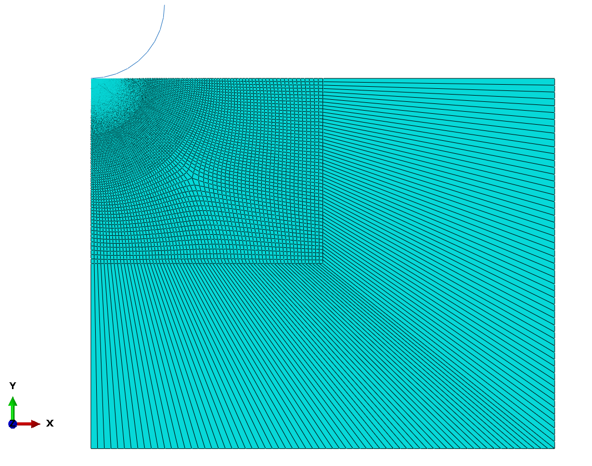
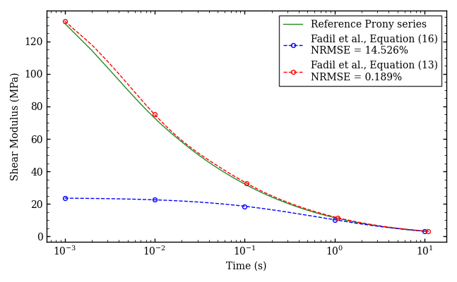
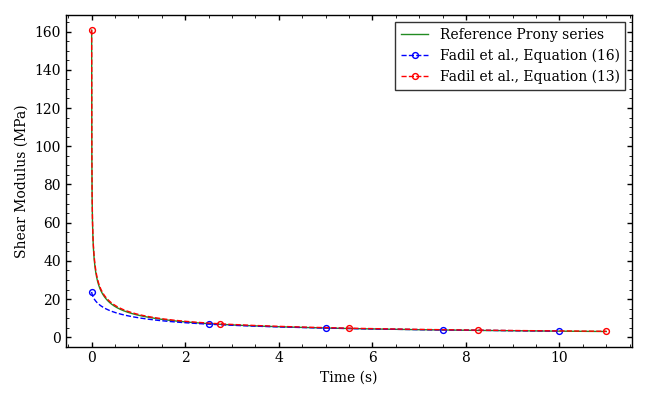
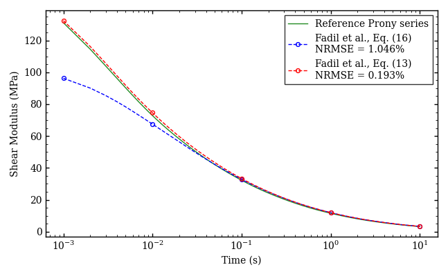
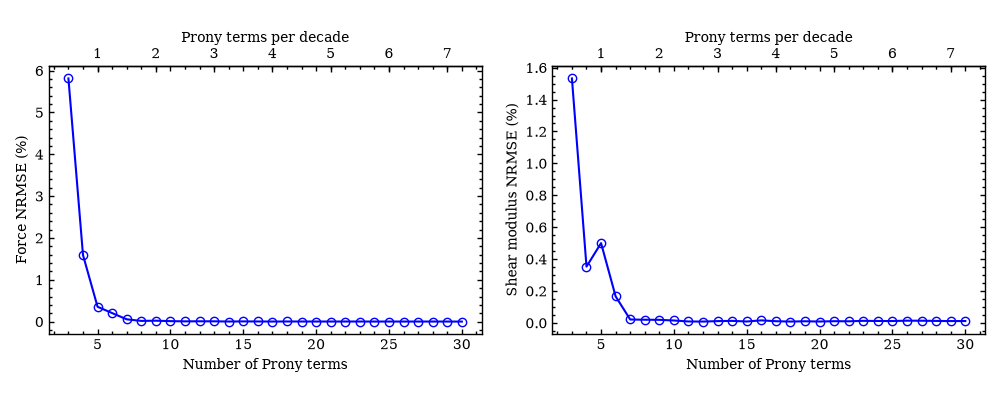

# Indentation Analysis

Python tools for analyzing spherical indentation of linear-elastic and linear-viscoelastic materials. The focus is on the viscoelastic method proposed by Fadil et al. (2018). An Abaqus implementation is included for evaluating the methods with finite element simulations.

## Repository Contents

```text
Indentation-Analysis/
│
├── linear_elastic/
│   └── linear_elastic_indentation.py
│
├── viscoelastic/
│   ├── fadil_equation_13.py
│   ├── fadil_equation_13_relaxation_time_convergence.py
│   └── force_indenter.csv
│
├── abaqus/
│   ├── model/
│   │   └── 02_viscoelastic_axisymmetric.cae
│   │
│   ├── input_files/
│   │   ├── indentation_1s.inp
│   │   ├── indentation_0_1s.inp
│   │   └── indentation_0_01s.inp
│   │
│   └── abaqus_fadil_equation_comparison.py
│
├── figures/
│   ├── axisymmetric_fe_mesh.png
│   ├── shear_modulus_loading_time_1s.png
│   ├── shear_modulus_loading_time_0_1s.png
│   ├── shear_modulus_loading_time_0_01s.png
│   └── relaxation_time_convergence.png
│
└── README.md
```

## Theoretical Background

### Spherical Indentation of Linear-Viscoelastic Materials

The indentation force of a linear-viscoelastic material depends on the current depth and on the loading history. Following Fadil et al. (2018), and assuming a time-independent Poisson's ratio, the force of a rigid spherical indenter is related to the shear relaxation modulus through the convolution integral (Eq. 11):

$$
P(t)=\frac{8\sqrt{R}}{3(1-\nu)}
\int_0^t G(t-\tau)
\frac{d h^{3/2}(\tau)}{d\tau}\,d\tau
$$

For a two-stage loading history, Eq. (13) in Fadil et al. is

$$
\begin{aligned}
P(t)&=
\frac{8\sqrt{R}}{3(1-\nu)}
\int_0^{t_1}G(t-\tau)
\frac{d h_1^{3/2}(\tau)}{d\tau}\,d\tau\\
&\quad+
\frac{8\sqrt{R}}{3(1-\nu)}
\int_{t_1}^{t}G(t-\tau)
\frac{d h_2^{3/2}(\tau)}{d\tau}\,d\tau,
\qquad t\geq t_1
\end{aligned}
$$

During a constant-depth hold, the derivative of $h^{3/2}$ is zero and the force evolution is governed by relaxation from the preceding loading.

Variables:

- $P(t)$: indentation force
- $R$: indenter radius
- $\nu$: Poisson's ratio (time-independent)
- $G(t)$: shear relaxation modulus
- $h(t)$: indentation depth
- $\tau$: integration variable (earlier time)
- $t_1$: transition time between the two stages
- $h_1(t)$, $h_2(t)$: depth histories of the two stages

Assumptions: linear viscoelasticity, rigid sphere, frictionless contact, time-independent $\nu$ and a non-decreasing contact area.

### Closed-Form Expression: Equation (16) in Fadil et al.

During the hold phase the depth is constant, and $G(t)$ follows directly from the measured force:

$$
G(t)=\frac{3}{16}\frac{(1-\nu)D}{a^3}P(t)
$$

with $D$ the indenter diameter and $a$ the contact radius. For a sphere,

$$
a=\sqrt{Rh}
$$

so with $D=2R$:

$$
G(t)=\frac{3}{8}\frac{(1-\nu)R P(t)}{a^3}
$$

No inverse problem needs to be solved, but the contact radius must remain constant. The expression is therefore only valid for the hold phase, not during the ramp.

### Material Properties and Elastic Constants

For an isotropic linear-elastic material, $E$ and $\nu$ are used as the two independent constants.

- $E$: Young's modulus
- $\nu$: Poisson's ratio (time-independent)
- $G$: shear modulus
- $G_0$: instantaneous shear modulus

$$
G_0=\frac{E}{2(1+\nu)}
$$

$G_0$ and $\nu$ are assumed known. The time-dependent response is represented by a Prony series.

### Prony-Series Representation

$$
G(t)=G_0\left[
1-\sum_{i=1}^{p}g_i
\left(1-e^{-t/\tau_i}\right)
\right]
$$

- $p$: number of Prony terms
- $g_i$: normalized Prony coefficient of term $i$
- $\tau_i$: relaxation time of term $i$

The long-term modulus is

$$
G_\infty=G_0\left(1-\sum_{i=1}^{p}g_i\right)
$$

so the coefficients are constrained by

$$
g_i\geq 0,
\qquad
\sum_{i=1}^{p}g_i\leq 1
$$

### Numerical Implementation of the Convolution Integral

With the geometric factor

$$
C=\frac{8\sqrt{R}}{3(1-\nu)}
$$

and the Prony series inserted, the force becomes

$$
P(t)=CG_0\int_0^t
\left[
1-\sum_{i=1}^{p}g_i
\left(1-e^{-(t-\tau)/\tau_i}\right)
\right]
\frac{d h^{3/2}(\tau)}{d\tau}\,d\tau
$$

An integral is defined for each Prony term:

$$
J_i(t)=
\int_0^t e^{-(t-\tau)/\tau_i}
\frac{d h^{3/2}(\tau)}{d\tau}\,d\tau
$$

For discrete times $t_0,t_1,\ldots,t_n$, splitting the integral at $t_{n-1}$ and using

$$
e^{-(t_n-\tau)/\tau_i}
=
e^{-(t_n-t_{n-1})/\tau_i}
e^{-(t_{n-1}-\tau)/\tau_i}
$$

gives the recursion

$$
J_i(t_n)
=e^{-(t_n-t_{n-1})/\tau_i}J_i(t_{n-1})
+
\int_{t_{n-1}}^{t_n}
e^{-(t_n-\tau)/\tau_i}
\frac{d h^{3/2}(\tau)}{d\tau}\,d\tau
$$

#### Piecewise-Linear Approximation

$h^{3/2}(t)$ is assumed to vary linearly between sampling points:

$$
\frac{d h^{3/2}(\tau)}{d\tau}
\approx
\frac{h_n^{3/2}-h_{n-1}^{3/2}}
{t_n-t_{n-1}}
$$

with $h_n=h(t_n)$. Evaluating the remaining integral gives

$$
J_i(t_n)
=e^{-\Delta t_n/\tau_i}J_i(t_{n-1})
+
\frac{\tau_i}{\Delta t_n}
\left(h_n^{3/2}-h_{n-1}^{3/2}\right)
\left(1-e^{-\Delta t_n/\tau_i}\right)
$$

where

$$
\Delta t_n=t_n-t_{n-1}
$$

Only $J_i(t_{n-1})$ is needed for each step, with $J_i(t_0)=0$. The exponential integration is exact for a piecewise-linear $h^{3/2}(t)$. This does not mean that $h(t)$ itself is linear.

### Force Expression

Using $\int_0^t \frac{d h^{3/2}}{d\tau}\,d\tau = h^{3/2}(t)-h^{3/2}(0)$, $h(0)=0$ and the definition of $J_i$:

$$
P(t)=CG_0\left[
h^{3/2}(t)+
\sum_{i=1}^{p}g_i
\left(J_i(t)-h^{3/2}(t)\right)
\right]
$$

The force is linear in the unknown coefficients $g_i$.

### Matrix Formulation

Evaluating the force at $t_1,\ldots,t_n$ gives the reduced system

$$
\mathbf{b}
=
\frac{\mathbf{P}}{CG_0}-\mathbf{h}
=
\mathbf{B}\mathbf{g}
$$

with

$$
\mathbf{h}=
\begin{bmatrix}
h_1^{3/2}\\
\vdots\\
h_n^{3/2}
\end{bmatrix},
\qquad
\mathbf{B}=
\begin{bmatrix}
J_1(t_1)-h_1^{3/2} & \cdots & J_p(t_1)-h_1^{3/2}\\
\vdots & \ddots & \vdots\\
J_1(t_n)-h_n^{3/2} & \cdots & J_p(t_n)-h_n^{3/2}
\end{bmatrix},
\qquad
\mathbf{g}=
\begin{bmatrix}
g_1\\
\vdots\\
g_p
\end{bmatrix}
$$

The coefficients are found by constrained least squares:

$$
\min_{\mathbf{g}}
\left\|\mathbf{B}\mathbf{g}-\mathbf{b}\right\|^2
+
\lambda^2\left\|\mathbf{D}\mathbf{g}\right\|^2
$$

subject to

$$
g_i\geq 0,
\qquad
\sum_{i=1}^{p}g_i\leq 1
$$

- $\mathbf{B}$: reduced system matrix from the indentation history
- $\mathbf{b}$: normalized force vector minus the instantaneous elastic part
- $\mathbf{g}$: unknown Prony coefficients
- $\mathbf{D}$: second-difference matrix for optional smoothness regularization
- $\lambda$: regularization strength

$G_0$ and $\tau_i$ are known, so only $g_i$ is determined. Currently $\lambda=0$ (no regularization).

## Applicability of the Methods

The convolution-based method recovers the shear relaxation response from the force and depth histories. It assumes a monotonically increasing indentation history (ramp followed by hold). The recursive formulation is a numerical way of evaluating the Prony-series convolution integral. It is not Eq. (13) itself.

The closed-form method (Eq. 16) uses the hold phase only, where depth and contact radius are constant.

## Finite Element Model

### Geometry and Element Formulation

The simulations use an axisymmetric Abaqus model. A rigid spherical indenter is pressed into a viscoelastic specimen under displacement control, with geometric nonlinearity enabled.

- Specimen: 40 mm height, 50 mm radius
- Infinite-element region: 40 mm height, 50 mm radial extent, to approximate an unbounded domain
- Specimen elements: CAX4H
- Infinite elements: CINAX4
- Indenter: analytical rigid sphere, radius 15.875 mm

The infinite-element region is positioned relative to the pole, which coincides with the indenter contact point.

The model agrees well with the analytical solution for reaction force, contact area, contact pressure and most stress components. The peak radial stress shows a larger discrepancy, so it is more sensitive to discretization and/or the domain approximation.



*Figure 1. Axisymmetric FE mesh with specimen, infinite-element region and rigid indenter.*

**Important:** After generating an input file from the `.cae` model, change the element type of the infinite-element region manually.

```text
*Element, type=CAX4
```

to

```text
*Element, type=CINAX4
```

### Contact Definition

Frictionless tangential behavior. Normal contact is enforced with the direct method.

### Material Properties

| Property | Symbol | Value |
|---|---|---:|
| Young's modulus | $E$ | 476.0142 MPa |
| Poisson's ratio | $\nu$ | 0.48 |
| Initial shear modulus | $G_0$ | 160.8156 MPa |

The time-dependent response is an 11-term Prony series:

| $i$ | $g_i$ | $\tau_i$ (s) |
|---:|---:|---:|
| 1 | 0.1621 | 0.0010 |
| 2 | 0.2670 | 0.0036 |
| 3 | 0.1898 | 0.0132 |
| 4 | 0.1440 | 0.0479 |
| 5 | 0.0990 | 0.1741 |
| 6 | 0.0640 | 0.6325 |
| 7 | 0.0375 | 2.2974 |
| 8 | 0.0202 | 8.3453 |
| 9 | 0.0097 | 30.3143 |
| 10 | 0.0042 | 110.1169 |
| 11 | 0.0019 | 400.0000 |

### Analysis Steps

Two consecutive viscoelastic steps are used:

1. **Ramp:** linear displacement to a final depth of 0.3 mm.
2. **Relaxation:** depth held constant for 10 s.

| Case | Ramp duration (s) | Final depth (mm) | Rate (mm/s) |
|---|---:|---:|---:|
| 1 | 1.0 | 0.3 | 0.3 |
| 2 | 0.1 | 0.3 | 3.0 |
| 3 | 0.01 | 0.3 | 30.0 |

The final depth is the same in all cases, so the influence of indentation rate can be isolated. Automatic time incrementation is used in both steps. The ramp duration is the step duration, not the increment size.

### Output Requests

- Indenter reaction force (RF2)
- Indenter displacement (U2)
- Contact area (CAREA)
- Contact force (CFN2)

RF2 and U2 are history output at the indenter reference point. CAREA and CFN2 are recorded every 0.001 s. Field output is requested for selected nodal, element and contact quantities.

## Numerical Implementation

### Convolution-Based Method

`fadil_equation_13.py` uses the Prony-series convolution formulation described above. The coefficients $g_i$ are found from $\mathbf{b}=\mathbf{B}\mathbf{g}$ using constrained least squares with $g_i\geq 0$ and $\sum g_i\leq 1$. $G_0$ is calculated from the elastic properties and $\lambda=0$.

### Closed-Form Method

Eq. (16) is evaluated using the measured force and the contact radius $a=\sqrt{Rh}$ during the hold phase only:

$$
G(t)=\frac{3}{8}\frac{(1-\nu)RP(t)}{a^3}
$$

### Relaxation-Time Discretization

The relaxation times are spaced logarithmically over the selected time range. A convergence study varies the number of relaxation times per decade to find a balance between numerical stability and resolution of the relaxation response.

## Results

### Influence of Loading Time

Convolution-based and closed-form results are compared with the reference Prony-series response for ramp durations of 1.0 s, 0.1 s and 0.01 s.

**1.0 s ramp duration**



**0.1 s ramp duration**



**0.01 s ramp duration**



### Relaxation-Time Discretization Convergence



### Quantitative Error Comparison

The error is quantified with the normalized root mean square error:

$$
\mathrm{NRMSE}=
\frac{
\sqrt{
\frac{1}{n}\sum_{i=1}^{n}
\left(
G_{\mathrm{extracted}}(t_i)
-
G_{\mathrm{reference}}(t_i)
\right)^2
}
}{
\max_{1\leq i\leq n}
\left|G_{\mathrm{reference}}(t_i)\right|
}
\times 100\%
$$

| Ramp duration | Convolution-based NRMSE (%) | Closed-form NRMSE (%) |
|---|---:|---:|
| 1.0 s | 0.189 | 14.526 |
| 0.1 s | 0.191 | 3.779 |
| 0.01 s | 0.193 | 1.046 |

## Requirements

Standalone scripts: NumPy, Matplotlib, SciPy.

Abaqus implementation: Abaqus/CAE Python environment, NumPy, Matplotlib, SciPy.

## Usage

### Standalone Python Scripts

Run the scripts in a Python environment with the dependencies installed. The force data is read from `force_indenter.csv`, which must be in the same directory as the script unless the path is changed.

### Abaqus Implementation

Requires an existing `.odb` containing the indentation history output. The script is run in the Abaqus/CAE Python environment.

Two analysis steps are assumed. The first can be viscoelastic or static. If it is static, the indentation history is taken from the second step. If both are viscoelastic, the convolution-based method uses the full monotonically increasing history. The closed-form method uses the hold phase only.

## References

Fadil, H., Jelagin, D., & Larsson, P.-L. (2018). *On the Measurement of Two Independent Viscoelastic Functions with Instrumented Indentation Tests.* Experimental Mechanics, 58, 301–314. https://doi.org/10.1007/s11340-017-0342-7

## Status

The linear-elastic implementation is an initial investigation of the numerical behavior of the indentation model. Current work focuses on the viscoelastic methods: numerical stability, relaxation-time discretization and performance for different loading durations. The Abaqus implementation is under continued development and validation.